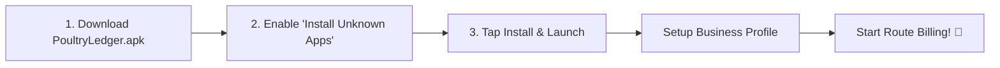
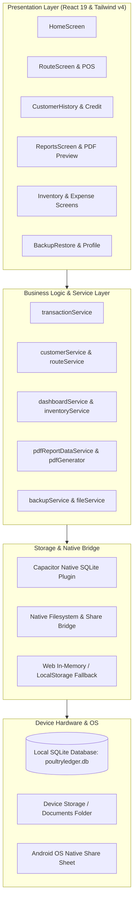
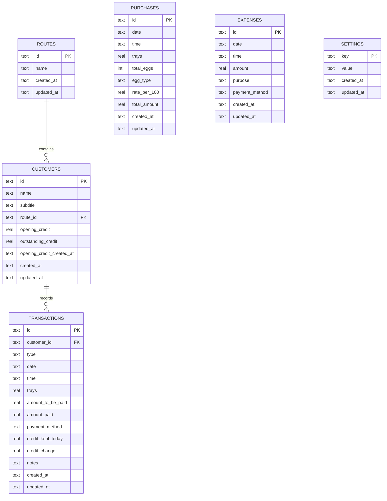

# 🥚 PoultryLedger

<div align="center">


<br/>
**The Ultimate Offline-First Egg Distribution, Route Billing & Credit Ledger App**

<p align="center">
  <a href="https://github.com/VinayKumar7549/PoultryLedger/releases/latest">
    
  </a>
  <a href="https://github.com/VinayKumar7549/PoultryLedger/releases/latest/download/PoultryLedger.apk">
    
  </a>
</p>

[](https://react.dev/)
[](https://www.typescriptlang.org/)
[](https://capacitorjs.com/)
[](https://github.com/capacitor-community/sqlite)
[](https://tailwindcss.com/)
[](https://developer.android.com/)
[](LICENSE)

<br/>

[📥 Download APK](#-download--installation) • [✨ Key Features](#-key-features) • [📱 App Screens & Flow](#-app-screens--workflow) • [🏗️ Architecture](#-system-architecture) • [📊 Reports Engine](#-pdf-reports--analytics) • [🚀 Developer Setup](#-developer-guide--build)

</div>

---

## 📖 Overview

**PoultryLedger** is a purpose-built, high-performance, **100% offline-first Android & Web application** engineered specifically for egg distributors, poultry farm owners, wholesale suppliers, and field delivery drivers.

Managing daily egg deliveries, multiple vehicle routes, complex customer credit balances (Khata), cash/online payments, egg damage tracking, and farm procurement on paper registers leads to costly accounting errors and forgotten receivables. **PoultryLedger** streamlines the entire egg distribution lifecycle right on your mobile phone:

- 📴 **100% Offline-First:** Works anywhere—remote rural farms, highway transit, or underground market stalls with zero internet dependency.
- ⚡ **Rapid 3-Tap Field Billing:** Record tray deliveries (normal & damaged), collect payments, and update credit balance in seconds per shop.
- 📲 **On-the-Spot UPI QR Code Payments:** Display your custom business QR code for instant UPI payment collection directly from the delivery screen.
- 📊 **Instant Vector PDF Statements:** Generate branded, professional customer credit statements, daily settlement sheets, and route summaries with one tap and share directly via WhatsApp.
- 🔒 **Rock-Solid Data Ownership:** Embedded relational SQLite database with one-click JSON backup, file export, and instant database restore.

---

## 📥 Download & Installation

The official production APK is published and available on **GitHub Releases**:

<div align="center">

### 🚀 **[👉 Download PoultryLedger.apk (Latest Release) 👈](https://github.com/VinayKumar7549/PoultryLedger/releases/latest/download/PoultryLedger.apk)**

*Or browse all versions on the [GitHub Releases Page](https://github.com/VinayKumar7549/PoultryLedger/releases).*

</div>

### 📦 APK File Specifications

| Attribute | Details |
| :--- | :--- |
| **Release Asset** | [`PoultryLedger.apk`](https://github.com/VinayKumar7549/PoultryLedger/releases/latest/download/PoultryLedger.apk) |
| **Package Name** | `com.vinay.poultryledger` |
| **Supported OS** | Android 7.0 (Nougat) up to Android 14+ |
| **Storage Engine** | Embedded SQLite (`poultryledger.db`) |
| **Network Requirement** | 100% Offline (No cloud server or subscription needed) |
| **Architecture** | Universal (ARM64, ARMv7, x86_64) |

### 📲 How to Install on Android in 3 Steps



1. **Download:** Tap the download link above directly on your Android phone.
2. **Allow Installation:** If prompted by Chrome or your File Manager, enable *"Allow from this source"* in Settings.
3. **Open & Onboard:** Launch **PoultryLedger**, enter your business name, contact number, and UPI QR code to personalize all receipts and statements!

---

## ✨ Key Features

### 🚚 1. Route & Customer Logistics
- **Organized Delivery Routes:** Create and manage delivery routes (e.g., *Market Line, Route A - Town Center, Highway Zone*).
- **Customer Directory:** Track shop names, phone numbers, location landmarks/subtitles, and delivery sequencing.
- **Real-Time Balances:** Instant visual indicator of each customer's outstanding credit on their route card.
- **One-Tap Dial:** Call customers directly from their profile card to confirm deliveries.

### ⚡ 2. High-Speed Field Sales & Billing
- **Tray & Egg Counting:** Log delivery trays with automatic conversion (30 eggs/tray standard).
- **Normal & Damaged Egg Tracking:** Separate entry for standard and damaged/discounted egg stock.
- **Flexible Payment Methods:** Record payments via **Cash**, **Online / UPI**, or **Google Pay**.
- **Auto-Credit Calculation:** Automatic calculation of `(Amount to be Paid - Amount Paid) = Credit Kept Today`, instantly adjusting customer balances.
- **Pure Payment Collection:** Receive past pending credit payments without requiring a new sale entry.

### 📲 3. Built-in Dynamic UPI QR Code Payment
- **Instant Customer QR:** Display your registered UPI QR code during checkout so customers can scan and pay instantly.
- **Custom QR Generator / Upload:** Upload your Google Pay / PhonePe / Paytm / BHIM QR or auto-generate one from your UPI ID.

### 📒 4. Customer Khata & Credit Ledger
- **Complete Transaction History:** Full chronological timeline of egg sales, payment receipts, opening balances, and date-wise ledger balance changes.
- **Transaction Editing & Deletion:** Safely correct mistaken entries with automated ledger recalculation and balance consistency.
- **Instant WhatsApp Statement:** Send balance reminders with a single tap.
- **Customer Statement PDF:** Export itemized, date-filtered customer statements.

### 📦 5. Egg Inventory & Farm Procurement
- **Bulk Purchase Logging:** Record egg procurement from hatcheries/farms with tray quantity, total egg count, rate per 100 eggs, and total amount.
- **Egg Categorization:** Classify purchases into Normal vs Damaged eggs.
- **Live Stock Reconciliation:** Real-time visibility into **Purchased Stock vs Delivered Stock vs Damaged Wastage vs Remaining Stock in Hand**.

### 💸 6. Daily Expense & Cash Settlement
- **Daily Operating Expenses:** Log vehicle fuel, driver allowance, vehicle maintenance, plastic/paper tray costs, and misc expenses.
- **Clean Payment Method Selection:** Record Cash or Online expenses with zero clutter.
- **Cash-in-Hand Reconciliation:** Calculate actual physical cash balance by deducting daily cash expenses from daily cash collections.

### 📊 7. Executive Analytics & PDF Reports
Generate publication-quality, branded PDF documents directly on the device:
- 📄 **Customer Statement Report:** Date-ranged ledger breakdown with running balance.
- 📄 **Route Credit / Outstanding Report:** Full list of all debtors sorted by outstanding balance.
- 📄 **Daily Settlement Sheet:** Daily total sales, cash collections, online collections, expenses, and net profit.
- 📄 **Monthly Business Summary:** Revenue, procurement expenses, operating expenses, and gross profit.
- 📄 **Egg Stock & Wastage Ledger:** Stock intake vs deliveries vs breakage.
- 📄 **Expense Ledger Report:** Categorized expenditure breakdown.

### 💾 8. Safe Offline Backup & Restore
- **Device-Local Backups:** Generate full JSON database snapshots directly into your phone's storage.
- **Share & Cloud Sync:** Share backup archives to Google Drive, WhatsApp, or Email.
- **One-Click Restore:** Restore your entire database seamlessly onto a new or reset phone.
- **Automated Backup Reminders:** Configurable reminders ensure you never forget to safeguard your records.

---

## 📱 App Screens & Workflow

```
┌─────────────────────────────────────────────────────────────────────────────┐
│                              POULTRYLEDGER                                  │
├─────────────────┬─────────────────┬──────────────────┬──────────────────────┤
│ 🏠 Home         │ 🚚 Routes       │ ⚡ Sales / POS   │ 📒 Credit Ledger     │
│ • Daily Sales   │ • Route List    │ • Tray Inputs    │ • All Debtors        │
│ • Cash / Online │ • Customers     │ • Cash/UPI/GPay  │ • Balance Summary    │
│ • Gross Profit  │ • Outstanding ₹ │ • Instant UPI QR │ • WhatsApp Reminder  │
│ • Live Stock    │ • Add Customer  │ • Auto-Balance   │ • PDF Statement      │
├─────────────────┼─────────────────┼──────────────────┼──────────────────────┤
│ 📦 Inventory    │ 💸 Expenses     │ 📊 Reports (PDF) │ ⚙️ Settings / Backup │
│ • Egg Purchases │ • Fuel / Wages  │ • Daily Summary  │ • Business Profile   │
│ • Rate / 100    │ • Categorized   │ • Monthly P&L    │ • Custom UPI QR/Logo │
│ • Stock In-Hand │ • Payment Mode  │ • Route Report   │ • JSON Backup/Export │
│ • Breakage Log  │ • History Log   │ • Direct Share   │ • Database Restore   │
└─────────────────┴─────────────────┴──────────────────┴──────────────────────┘
```

---

## 🏗️ System Architecture

PoultryLedger is engineered with a modular, offline-first layered architecture ensuring high responsiveness and complete data safety:



---

## 🗄️ Database Schema

The core persistence engine runs on SQLite (`poultryledger.db`) with relational integrity and indexed queries:



---

## 📄 PDF Reports & Analytics

PoultryLedger includes an on-device document generation engine built on `jspdf` and `jspdf-autotable`. All PDFs are generated locally in milliseconds with customized business headers:

| Report Type | Purpose & Description | Output Options |
| :--- | :--- | :--- |
| **Customer Statement** | Itemized invoice & payment ledger with previous balance, deliveries, payments, and closing balance. | View, Download, WhatsApp Share |
| **Outstanding Credit Report** | Master list of all customers with pending balance, grouped by route, with totals. | View, Download, Native Share |
| **Daily Settlement Report** | Reconciles daily egg trays sold, cash collected, UPI received, expenses, and cash in hand. | View, Download, Native Share |
| **Sales & Revenue Report** | Date-ranged analysis of egg volume, average rates, and gross turnover. | View, Download, Native Share |
| **Inventory & Procurement** | Batch-wise egg purchases, farm rates per 100, wastage count, and net stock. | View, Download, Native Share |
| **Monthly Profit & Loss** | High-level summary of total sales vs egg purchase cost vs expenses = gross profit. | View, Download, Native Share |

---

## 🛠️ Technology Stack

| Category | Technology | Description |
| :--- | :--- | :--- |
| **Framework** | [React 19](https://react.dev/) | High-performance modern UI component architecture |
| **Language** | [TypeScript 5.7](https://www.typescriptlang.org/) | Strict type safety and robust data contracts |
| **Build Tool** | [Vite 8](https://vite.dev/) | Next-generation ultra-fast frontend build tool |
| **Styling** | [Tailwind CSS v4](https://tailwindcss.com/) | Modern utility-first responsive styling engine |
| **Mobile Runtime** | [Capacitor 8](https://capacitorjs.com/) | Cross-platform native runtime for Android |
| **Database** | [`@capacitor-community/sqlite`](https://github.com/capacitor-community/sqlite) | Native SQLite database for Android with zero latency |
| **PDF Generation** | [`jspdf`](https://github.com/parallax/jsPDF) + [`jspdf-autotable`](https://github.com/simonbengtsson/jsPDF-AutoTable) | Client-side vector PDF document creation |
| **File Sharing** | [`@capacitor/share`](https://capacitorjs.com/docs/apis/share) + [`@capacitor/filesystem`](https://capacitorjs.com/docs/apis/filesystem) | Native file system access and system share sheet |
| **File Picker** | [`@capawesome/capacitor-file-picker`](https://capawesome.io/plugins/file-picker/) | Native document picker for seamless database restores |

---

## 🚀 Developer Guide & Build

### 📋 Prerequisites
- **Node.js**: v20.x or later
- **Package Manager**: `npm` or `pnpm`
- **Android Studio**: Ladybug / Meerkat or later
- **Java**: JDK 17 or JDK 21

### 💻 1. Clone & Install Dependencies

```bash
# Clone repository
git clone https://github.com/VinayKumar7549/PoultryLedger.git

# Navigate into project directory
cd PoultryLedger

# Install dependencies
npm install
```

### 🌐 2. Run Local Web Development Server

```bash
# Start Vite development server
npm run dev
```
> **Note:** When running in the browser, PoultryLedger automatically uses its built-in Web In-Memory / LocalStorage database simulation so you can develop and test without needing an Android emulator.

### 📱 3. Build & Sync with Android

```bash
# 1. Build the production web bundle
npm run build

# 2. Sync web assets and plugins to the native Android project
npx cap sync android

# 3. Open the Android project in Android Studio
npx cap open android
```

### 📦 4. Build Signed Android APK from Terminal

```bash
# Navigate to the Android directory and run Gradle
cd android
./gradlew assembleRelease

# The generated APK will be located at:
# android/app/build/outputs/apk/release/app-release-unsigned.apk (or signed)
```

---

## 📂 Project Structure

```
PoultryLedger/
├── 📄 capacitor.config.ts     # Capacitor native runtime configuration
├── 📄 package.json            # Project dependencies and build scripts
├── 📄 vite.config.ts          # Vite build configuration
├── 📁 android/                # Native Android Studio project & Gradle config
└── 📁 src/
    ├── 📄 App.tsx             # Root application & global navigation state
    ├── 📄 main.tsx            # React application entry point
    ├── 📄 index.css           # Global Tailwind CSS imports
    ├── 📁 types/              # Global TypeScript interfaces & types
    ├── 📁 database/           # SQLite connection, repositories & migrations
    │   ├── 📄 database.ts     # Database singleton & Web fallback driver
    │   └── 📁 migrations/     # Initial SQL schemas and index definitions
    ├── 📁 services/           # Core business logic & domain services
    │   ├── 📄 transactionService.ts     # Sales & payment calculations
    │   ├── 📄 customerService.ts        # Customer directory & balances
    │   ├── 📄 routeService.ts           # Delivery routes & sequencing
    │   ├── 📄 dashboardService.ts       # Metric aggregations & profit math
    │   ├── 📄 pdfGenerator.ts           # Vector PDF layout & formatting
    │   ├── 📄 pdfReportDataService.ts   # Report data filtering & queries
    │   ├── 📄 backupService.ts          # JSON database snapshots & restores
    │   └── 📄 fileService.ts            # Native file saving & sharing
    ├── 📁 pages/              # Primary screen views
    │   ├── 📄 HomeScreen.tsx            # Executive dashboard & metrics
    │   ├── 📄 RouteScreen.tsx           # Route customer list & quick billing
    │   ├── 📄 TransactionScreen.tsx     # Sale/Payment POS with UPI QR
    │   ├── 📄 CustomerHistoryScreen.tsx # Chronological customer ledger
    │   ├── 📄 CreditRecordsScreen.tsx   # Global credit & debtors list
    │   ├── 📄 InventoryScreen.tsx       # Egg procurement & stock balance
    │   ├── 📄 AddExpenseScreen.tsx      # Expense recording
    │   ├── 📄 ExpenseHistoryScreen.tsx  # Categorized expense ledger
    │   ├── 📄 ReportsScreen.tsx         # Comprehensive PDF reports engine
    │   ├── 📄 BackupRestoreScreen.tsx   # Backup, export & restore hub
    │   └── 📄 BusinessProfileScreen.tsx # Business details & QR configuration
    ├── 📁 components/         # Reusable UI components
    │   ├── 📁 common/         # Modals, Badges, SearchBar, Icons, QR Modal
    │   └── 📁 layout/         # Navigation drawer & side menu
    └── 📁 utils/              # Formatting, date utilities & math helpers
```

---

## 🔒 Data Privacy & Security

- **100% On-Device:** Your sales records, customer lists, profit figures, and transactions remain strictly on your phone.
- **Zero Cloud Dependence:** No mandatory accounts, subscriptions, or external servers tracking your business metrics.
- **Full Ownership:** Export your entire database to standard JSON anytime you wish.

---

## 🤝 Contributing

Contributions are welcome! If you'd like to improve PoultryLedger:

1. **Fork** the repository.
2. Create a feature branch: `git checkout -b feature/AmazingFeature`.
3. Commit your changes: `git commit -m 'Add some AmazingFeature'`.
4. Push to the branch: `git push origin feature/AmazingFeature`.
5. Open a **Pull Request**.

---

## 📜 License

Distributed under the **MIT License**. See `LICENSE` for more information.

---

<div align="center">

**Built with ❤️ for Poultry Farmers & Egg Distributors worldwide.**

⭐ If you find PoultryLedger helpful, please give this repository a star!

</div>
